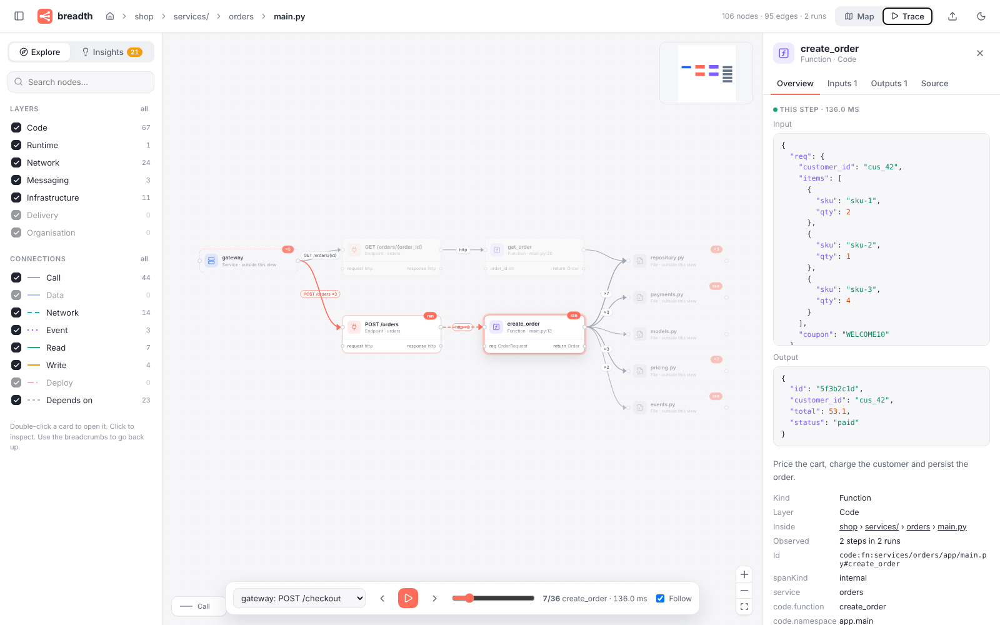

# noodles

**See how your system flows.** noodles turns any codebase, trace and infrastructure into an n8n-style canvas: nodes with input ports on the left and output ports on the right, connected left to right. Click a node to see what goes in and what comes out.



- **Every kind of flow**, not just HTTP: function calls, shared state, database reads and writes, HTTP between services, Kafka topics, Kubernetes networking, Terraform dependencies and security group rules.
- **One graph format.** Collectors write [`flowgraph.json`](schema/flowgraph.schema.json); the UI only reads it. A new collector never needs UI changes.
- **Drill down any level**: system > service > module > file > class > function. Double-click to open a node, use the breadcrumbs to go back up.
- **Replay real runs.** Import OpenTelemetry traces and step through a request like an n8n execution, with the real input and output at every node.
- **Problems you can see.** Rules over the graph flag N+1 queries, repeated work, missed parallelism, dead code, duplicate logic, unused infrastructure, contract drift, unhandled errors and personal data sent to third parties, and highlight them on the canvas. See [Insights](#insights).
- **Watch your coding agent build.** `noodles watch` keeps the canvas live while you or your agent edit: Claude Code, Copilot, Cursor, Gemini CLI, Windsurf, Antigravity, Codex or anything else. New and changed functions light up as they appear, even before they are saved, with a feed of what each task changed. An MCP server gives the agent the same graph as tools. See [Live mode](#live-mode-watch-a-coding-agent).
- **Zero config, fully local.** Nothing leaves your machine. LLM features are optional, off by default, and work with any provider: Claude, OpenAI, Gemini, Ollama, or anything OpenAI-compatible.

**Try it without installing anything:** the [landing page](#publishing-the-site) has a box where you paste a public GitHub repository. It is scanned in your browser: files come straight from GitHub and are parsed in a Web Worker with tree-sitter compiled to WebAssembly. No server is involved and nothing is uploaded.

## Install

Requires Node 20 or newer.

```sh
git clone https://github.com/theorjiugovictor/noodles
cd noodles
npm install
npm run build          # builds the UI and bundles the CLI into cli/dist/noodles.mjs
npm link -w cli        # puts `noodles` on your PATH (optional)
```

Without `npm link`, run `node /path/to/noodles/cli/dist/noodles.mjs` instead of `noodles`.

> The npm package name `noodles` belongs to an unrelated project, so do not use `npx noodles`.

## Quick start

```sh
cd ~/code/some-repo
noodles scan .                 # writes flowgraph.json
noodles serve                  # opens http://127.0.0.1:4321
```

Add runtime data from OpenTelemetry:

```sh
noodles import-traces traces.otlp.json --merge flowgraph.json
noodles serve
```

Then switch the top bar to **Trace**, pick an execution and press play (or use ← / →).

### The demo

```sh
npm run demo        # builds the demo graphs and serves the shop example
```

`examples/shop` is a small shop with four services: a TypeScript gateway (Express), orders (Python/FastAPI), payments (Python/Flask) and notifier (TypeScript, Kafka consumer). It also includes Postgres, Kafka, a Terraform plan, Kubernetes manifests and two recorded checkouts (one paid, one declined) in [`examples/shop/traces/checkout.otlp.json`](examples/shop/traces/checkout.otlp.json).

After the merge, each service is a single node across all layers:

- **Code:** its source directory.
- **Infrastructure:** its Kubernetes Deployment.
- **Runtime:** its OpenTelemetry service.

Every trace step lands on the function that produced it. `npm run demo:build` also writes `examples/noodles.flowgraph.json`, which is noodles scanning itself.

## Live mode: watch a coding agent

```sh
cd ~/code/some-repo
noodles watch                  # scans, serves http://127.0.0.1:4321 and keeps watching
```

Every save triggers an incremental rescan (unchanged files come from a cache), and the browser updates over Server-Sent Events without losing your place:

- Functions, endpoints and files that just appeared get a **new** badge; changed ones get **edited**. A folder or file card lights up when something inside it changed.
- With **Follow** on (the default), the canvas opens the level where the latest change happened.
- The **Live** tab lists each change (what was added, edited or removed, and any new insights it caused, such as dead code or an N+1 query) next to the task that led to it.

This works with any agent or editor, because it watches the files. Three optional add-ons do more:

| | What it adds | Setup |
| --- | --- | --- |
| **Hooks** | The agent's task (your prompt) in the feed, and its edits credited to it | `noodles connect <agent> --write` |
| **Editor extension** | Edits appear before they are saved (agents in the editor often leave files unsaved while you review) | `noodles editor install` |
| **MCP server** | The agent can ask noodles about the code (callers, impact of a change, insights) and report what it is working on | written by `noodles connect` too |

### Connect your agent

Run this in your project. It merges into the agent's project config files and keeps your own entries; run it again at any time. Leave out `--write` to just print what to add.

```sh
noodles connect claude --write        # or: copilot cursor gemini windsurf antigravity codex, or all
```

| Agent | Hooks file | Task (prompt) | Edits | MCP config |
| --- | --- | --- | --- | --- |
| Claude Code | `.claude/settings.json` | `UserPromptSubmit` | `PostToolUse` (Edit, Write, …) | `.mcp.json` |
| GitHub Copilot (VS Code agent mode) | `.github/hooks/noodles.json` | `UserPromptSubmit` | `PostToolUse` | `.vscode/mcp.json` |
| Cursor | `.cursor/hooks.json` | `beforeSubmitPrompt` | `afterFileEdit` | `.cursor/mcp.json` |
| Gemini CLI | `.gemini/settings.json` | `BeforeAgent` | `AfterTool` (write_file, replace) | `.gemini/settings.json` |
| Windsurf (Cascade) | `.windsurf/hooks.json` | `pre_user_prompt` | `post_write_code` | `~/.codeium/windsurf/mcp_config.json` (printed, not written) |
| Antigravity | `.agents/hooks.json` | via MCP `noodles_report_task` | `PostToolUse` (write_to_file, replace_file_content, …) | Agent panel › MCP servers › raw config (printed) |
| Codex | `.codex/hooks.json` | `UserPromptSubmit` | `PostToolUse` (apply_patch) | `.codex/config.toml` |

Notes:
- Every hook runs `noodles hook`, which reads the event on stdin, recognises the agent from its format, forwards the event to `noodles watch` and exits 0 straight away. If `noodles watch` is not running it does nothing, so the agent is never blocked.
- VS Code also runs the hooks in `.claude/settings.json`. When both are configured, noodles shows each prompt once.
- Copilot hooks are a VS Code preview feature. Codex asks you to trust new hooks once (`/hooks`).
- Any other tool can report too: pipe `{"files": [...], "prompt": "..."}` to `noodles hook --agent Name`, or POST it to `http://127.0.0.1:4321/api/activity` with the header `x-noodles: 1`. Endpoints that change state or call an LLM require that header, so other web pages cannot trigger them.

### See edits before they are saved

```sh
noodles editor install                # VS Code, Cursor, Windsurf, Antigravity (whichever is on PATH)
```

The **noodles live** extension sends unsaved editor buffers to `noodles watch` (only to `127.0.0.1`, and only while it runs). The canvas then follows typing and agent edits that are still waiting for review. Changes scanned from unsaved text are tagged **unsaved** in the feed. When a buffer is saved or closed, the file on disk is used again. If your editor's command is not on PATH, use *Extensions › … › Install from VSIX* with the file from `noodles editor path`.

### MCP: the graph as tools for the agent

`noodles mcp` is a Model Context Protocol server (stdio). Its tools work for any MCP-capable agent:

| Tool | What the agent gets |
| --- | --- |
| `noodles_report_task` | Puts a one-line summary of the task in the live feed (the only way to get Antigravity's task in) |
| `noodles_overview` | Top-level structure, counts and the main insights of the repository |
| `noodles_find` | Functions, classes, files, endpoints and datastores by name or path |
| `noodles_node` | Where a node lives, its inputs and outputs, callers, callees, data reads and writes, and insights |
| `noodles_impact` | Everything that depends on a node, up to N hops, and the endpoints it is reachable from |
| `noodles_insights` | Findings, optionally for one file or folder |

MCP does not replace hooks. An MCP server hears from the agent only when the agent decides to call a tool, so it cannot observe edits; hooks and file watching capture those. What MCP adds is the other direction: the agent can use the graph instead of reading every file, and can say what it is doing. When `noodles watch` is running, the tools read its live graph. Otherwise they scan the project themselves.

## CLI

```
noodles scan <path> [--collector code,infra] [-o flowgraph.json] [--config file] [--exclude glob]... [--no-external] [--llm]
noodles import-traces <otlp.json>... [--merge flowgraph.json] [-o out.json]
noodles serve [flowgraph.json] [--port 4321] [--host 127.0.0.1] [--no-open]
noodles watch [path] [--port 4321] [--traces otlp.json]... [-o flowgraph.json] [--llm]
noodles connect <agent>... [--write] [--port 4321] [--no-mcp] [--no-hooks]
noodles editor install [--editor code|cursor|windsurf|antigravity]
noodles mcp [path] [--port 4321]
noodles hook [--port 4321] [--agent name]
noodles llm [providers|check]
noodles insights <flowgraph.json> [--json] [--write] [--fail-on warning|critical] [--rules a,b] [--list]
noodles validate <flowgraph.json>
noodles collectors
```

- **`scan`** runs every collector that recognises the target, unless you pass `--collector`. Their outputs are validated, merged on stable ids, and written as one graph.
- **`import-traces`** reads OTLP JSON in any of these shapes:
  - `{"resourceSpans": …}`
  - Tempo `{"batches": …}`
  - an array of documents
  - line-delimited JSON

  With `--merge`, it links spans to static code (by `code.filepath`/`code.function`, `code.namespace` and `http.route`) before merging.
- **`serve`** only listens on `127.0.0.1` and re-reads the graph file on every request, so re-running `scan` and refreshing the page is enough. The Source tab reads snippets from the scanned directory, and only from inside it.

### Optional config

Everything works without configuration. A `noodles.config.json` in the scanned directory, or one passed with `--config`, can set:

```json
{
  "collectors": ["code", "infra"],
  "exclude": ["**/generated/", "legacy/"],
  "include": ["src/", "services/"],
  "settings": { "code": { "includeExternal": false, "skipTests": true } },
  "llm": { "provider": "none" }
}
```

### LLM features (off by default)

Nothing is sent anywhere unless you configure a provider. With one configured you get:

- **`scan --llm`**: one-sentence descriptions for the most connected functions and modules that have no docstring.
- **Explain**: a button in the node panel of `noodles serve` / `noodles watch` that explains what a node does and how it connects.
- **`watch --llm`**: a one-line narration of each change in the live feed (sends names and file paths, not source).

Remote providers are announced on the terminal before the first request. Pick one in `noodles.config.json`, with environment variables (`NOODLES_LLM_PROVIDER`, `NOODLES_LLM_MODEL`, `NOODLES_LLM_BASE_URL`), or with `--llm-provider`, `--llm-model` and `--llm-base-url`:

```jsonc
{ "llm": { "provider": "anthropic" } }                                   // Claude, uses ANTHROPIC_API_KEY
{ "llm": { "provider": "openai", "model": "gpt-4.1-mini" } }             // OPENAI_API_KEY
{ "llm": { "provider": "gemini", "model": "gemini-2.5-flash" } }         // GEMINI_API_KEY
{ "llm": { "provider": "ollama", "model": "qwen2.5-coder" } }            // local, nothing leaves the machine
{ "llm": { "provider": "openai-compatible", "baseUrl": "http://localhost:4000/v1", "model": "my-model",
           "apiKeyEnv": "GATEWAY_KEY", "headers": { "x-team": "$TEAM_ID" } } }   // LiteLLM, Azure, any gateway
```

Built-in presets: `anthropic`, `openai`, `gemini`, `ollama`, `openrouter`, `groq`, `together`, `mistral`, `deepseek`, `xai`, `fireworks`, `lmstudio`, `vllm`, `llamacpp` and `openai-compatible`. `noodles llm` lists them with the key each one reads, and `noodles llm check` sends a test prompt to the configured provider. Endpoints on `localhost` count as local and need no key.

## Using the canvas

| | |
|---|---|
| Click a card | Open the side panel: **Overview** (connections, metadata), **Inputs**, **Outputs** (ports, plus real values per run), **Source** (file and line or resource ref, code preview, open in VS Code) |
| Double-click a card | Drill into it. Breadcrumbs at the top go back up; Backspace goes up one level |
| Dashed cards | Context: nodes outside the current level that connect to it |
| Edge labels | What flows (`POST /orders`, `INSERT orders`, `consume order-created`), how often (`×4`), `↻` when inside a loop. Faded edges are conditional |
| Left sidebar | Search (jumps to and selects the node), layer toggles, connection kinds |
| Trace mode | Pick a run, then step or play. The active node glows, visited nodes and edges are highlighted, `×N` badges show how often a node ran. **Follow** drills into the active node automatically |

Big graphs stay readable:

- The canvas opens at the highest useful level.
- It never renders more than 150 nodes; the least connected nodes are grouped into one "N more" node.
- Edges between hidden nodes are folded into their visible ancestors.

Recursion shows as a self-loop. Shared state (module globals, caches) and datastores are their own nodes, with read and write edges.

## Insights


When a graph is a graph, many problems stop hiding in code and become shapes. noodles runs a set of rules over any flowgraph. Each finding names the nodes, edges and (for runtime findings) the exact trace steps involved. Clicking it in the **Insights** tab opens the right level of the canvas, rings the nodes involved and dims everything else; runtime findings have a **Replay where it happens** button.

| Rule | Category | What it looks for | Needs traces? |
|---|---|---|---|
| `n-plus-one` | inefficiency | A datastore read inside a loop (directly or through callees), or the same query repeated in one request | no / yes |
| `repeated-work` | inefficiency | The same function called with identical input in one request | yes |
| `missed-parallelism` | inefficiency | Back-to-back sibling calls where neither uses the other's output | yes |
| `chatty-services` | inefficiency | Many calls between the same two services in one request | yes |
| `long-hop-chain` | inefficiency | A request crossing many services in sequence | yes |
| `dead-code` | redundancy | Functions nothing calls (entry points, framework hooks, callbacks and overrides excluded; public ones are low confidence) | no, traces add evidence |
| `duplicate-logic` | redundancy | Functions with identical or nearly identical syntax structure (names and literals ignored; MinHash over the tree) | no |
| `orphan-infra` | redundancy | Provisioned datastores and queues nothing reads, writes or sends traffic to | no |
| `race-risk` | risk | Shared state with several writers (module globals; databases written by several services) | no |
| `data-exposure` | risk | Personal or secret-looking fields (by name and value shape) sent to external APIs | yes |
| `contract-drift` | risk | Observed values whose type contradicts the declared parameter or return type | yes |
| `unhandled-errors` | risk | Errors that propagate all the way to the entry point; remote calls with no try/except or `.catch()` | yes / no |
| `static-runtime-mismatch` | risk | Calls seen at runtime that the code map does not contain (getattr, registries, DI) | yes |

Findings are **signals, not verdicts**. Rules see structure and flow, not the logic inside a function, and "dead" code might be called by a cron job, reflection or another repository you have not collected. Every finding carries a `confidence`.

```sh
noodles insights flowgraph.json                 # readable list
noodles insights flowgraph.json --json          # for tooling
noodles insights flowgraph.json --fail-on warning   # exit 1 in CI if any warning or critical finding
noodles insights --list                         # the rules
```

`scan` and `import-traces` store findings in the graph (`insights` in the schema; `--no-insights` to skip). The UI always re-runs the built-in rules on load and keeps findings other tools wrote into the file, so you can add your own rule engines. A rule is a plain object with `run(ctx, thresholds) => Insight[]` in [`insights/src/rules`](insights/src/rules); thresholds can be tuned per rule.

The shop demo is seeded with one realistic instance of each problem.

## How it fits together

```
schema/       flowgraph.schema.json, TypeScript types, validateGraph(), mergeGraphs()
insights/     rules over any flowgraph (pure TypeScript, runs in the CLI and the browser)
collectors/   core/ (interface, registry, file walker), code/, otel/, infra/
              browser.ts: the Node-free entry the in-browser repo scanner uses
              netflow/, messaging/, cicd/, org/   (stubs with a spec in their README)
cli/          the `noodles` command and the local server
ui/           React + React Flow (xyflow) + ELK
examples/     the shop demo
site/         the GitHub Pages landing page
```

### The graph format

Every collector produces the same JSON. The full contract is [`schema/flowgraph.schema.json`](schema/flowgraph.schema.json) (JSON Schema 2020-12).

```jsonc
{
  "version": "1.0",
  "nodes": [{
    "id": "code:fn:services/orders/app/main.py#create_order",   // stable across runs and collectors
    "name": "create_order",
    "kind": "function",        // function | module | service | datastore | queue | external_api |
                               // network_endpoint | infra_resource | pipeline | team | system | org
    "layer": "code",           // code | runtime | network | messaging | infra | delivery | org
    "parent": "code:file:services/orders/app/main.py",           // drives drill-down
    "aliases": ["py:services.orders.app.main.create_order"],      // other names for the same thing
    "inputs":  [{ "name": "req", "type": "OrderRequest" }],
    "outputs": [{ "name": "return", "type": "Order" }],
    "source":  { "file": "services/orders/app/main.py", "line": 14 },
    "metadata": { "language": "python" }
  }],
  "edges": [{
    "id": "call:a->b",
    "from": { "node": "a", "port": "return" }, "to": { "node": "b", "port": "req" },
    "kind": "call",            // call | data | network | event | read | write | deploy | depends_on
    "protocol": "http", "label": "POST /orders", "count": 3, "loop": false,
    "samples": [{ "value": { "input": {}, "output": {} } }]
  }],
  "executions": [{
    "id": "otel:4bf92f…", "name": "gateway: POST /checkout", "status": "ok",
    "steps": [{ "id": "s1", "node": "…", "parent": "s0", "via": "<edge id>", "input": {}, "output": {}, "start": 0, "end": 1.2, "status": "ok" }]
  }]
}
```

Conventions:

- `read` edges point from the datastore to the reader, and `write` edges from the writer to the datastore, so data always flows left to right.
- Times are epoch milliseconds.

**Merging** (`mergeGraphs`) is what lets layers meet. Nodes are unified when their ids or `aliases` collide; the first graph keeps its id, and later graphs fill in missing fields. Edges are re-pointed and deduped. The shared alias conventions are:

| Alias | Emitted by |
|---|---|
| `service:<name>` | code service directories (any dir with a manifest), Kubernetes workloads, OTel `service.name`, ECS/Lambda/Cloud Run resources, HTTP calls to bare host names |
| `datastore:<engine>` | code DB clients, OTel `db.system`, RDS/ElastiCache resources |
| `queue:<system>`, `topic:<name>` | code producers/consumers, OTel messaging spans, MSK/SQS/SNS |
| `route:<service>:<METHOD> <path>` | Express/Fastify/Flask/FastAPI/Nest routes, OTel server spans with `http.route` |
| `k8s:cluster` | Kubernetes manifests, EKS/GKE/AKS clusters |

## Collectors

| Name | Status | Reads |
|---|---|---|
| `code` | ✅ | Python, TypeScript, JavaScript (tree-sitter, WASM, no native build). Modules, classes, functions, params as inputs, return types as outputs, call edges (imports, re-exports, `self`/`this`, typed locals, attributes), loops, recursion, globals, DB/HTTP/queue clients, HTTP routes |
| `otel` | ✅ | OTLP JSON traces: services, endpoints, call edges with protocols, datastores, topics, external APIs, one replayable execution per trace |
| `infra` | ✅ | Terraform/OpenTofu `show -json` (state or plan) and raw `.tfstate`; Kubernetes YAML (workloads, Services, Ingress, ConfigMaps/Secrets by key only, PVCs, NetworkPolicies) |
| `netflow` | stub | VPC flow logs, service mesh: [spec](collectors/src/netflow/README.md) |
| `messaging` | stub | Kafka, SQS/SNS, RabbitMQ, AsyncAPI: [spec](collectors/src/messaging/README.md) |
| `cicd` | stub | GitHub Actions, GitLab CI, Argo CD: [spec](collectors/src/cicd/README.md) |
| `org` | stub | CODEOWNERS, Backstage: [spec](collectors/src/org/README.md) |

## Write a collector

A collector is an object with a name and two functions. It reads something and returns a flowgraph.

```ts
// collectors/src/compose/index.ts
import { promises as fs } from "node:fs";
import path from "node:path";
import { parse } from "yaml";
import { edgeId, SCHEMA_VERSION, type FlowGraph, type FlowNode, type FlowEdge } from "@noodles/schema";
import type { Collector } from "../core/types.js";

export const composeCollector: Collector = {
  name: "compose",
  description: "docker-compose services and their links",
  implemented: true,

  // Cheap check so `noodles scan` can pick this collector with zero config.
  async detect(target) {
    return fs.access(path.join(target, "docker-compose.yml")).then(() => true, () => false);
  },

  async collect(target) {
    const doc = parse(await fs.readFile(path.join(target, "docker-compose.yml"), "utf8"));
    const nodes: FlowNode[] = [];
    const edges: FlowEdge[] = [];
    for (const [name, svc] of Object.entries<any>(doc.services ?? {})) {
      nodes.push({
        id: `compose:${name}`,               // stable and namespaced
        name,
        kind: "service",
        layer: "infra",
        aliases: [`service:${name}`],        // merges with the code dir and OTel service of the same name
        metadata: { image: svc.image },
      });
      for (const dep of svc.depends_on ?? []) {
        const from = { node: `compose:${name}` };
        const to = { node: `compose:${dep}` };
        edges.push({ id: edgeId("depends_on", from, to), from, to, kind: "depends_on" });
      }
    }
    return { version: SCHEMA_VERSION, nodes, edges, sources: [{ collector: "compose", target }] } satisfies FlowGraph;
  },
};
```

Then register it in [`collectors/src/core/registry.ts`](collectors/src/core/registry.ts). That's all: the CLI validates its output against the schema, merges it with the other collectors, and the UI renders it.

Guidelines:

- **Stable ids**: derive them from names and paths, never from counters or timestamps. Prefix them with a namespace (`compose:`, `tf:`, `k8s:`).
- **Use `aliases`** for cross-layer identity (see the table above) instead of reusing another collector's ids.
- **Use `parent`** for real containment only. It is what drill-down follows.
- **Aggregate**: one edge per (from, to, kind), with `count`, rather than one edge per occurrence.
- **Never copy secrets or large payloads.** Keep samples small and truncated.
- **Add a test** that runs `validateGraph` on your output; see [`collectors/src/infra/infra.test.ts`](collectors/src/infra/infra.test.ts).

## Screenshots

The images in `docs/img` and `site/assets` are generated, not hand-made:

```sh
npm run build && npm run demo:build
npm i -D playwright && npx playwright install chromium   # once; not a project dependency
npm run screenshots          # serves the shop demo and captures map.png, hero-light.png, hero-dark.png
```

To capture your own graph, serve it and pass the URL: `node scripts/screenshots.mjs http://127.0.0.1:4321/`. You can also take a screenshot in the browser: the toolbar's fit-view button and the theme toggle give clean framing in both themes.

## Scanning a repository in the browser

`app/?repo=owner/repo` (or the box on the landing page) scans a public GitHub repository without a server:

1. One GitHub API request lists the files (`git/trees/HEAD?recursive=1`). Anonymous requests are limited to 60 per hour per visitor.
2. Python, TypeScript and JavaScript files are downloaded from `raw.githubusercontent.com` (not counted against that limit). Repositories with more than 1,200 code files are sampled, application code first, with a notice.
3. A Web Worker parses them with tree-sitter (WebAssembly), builds the graph and runs the insights.
4. The Source tab shows the lines straight from GitHub, with a link to the file.

`owner/repo`, GitHub URLs, `.git` URLs and `/tree/<branch>/<path>` (to scan a sub-folder) all work. Private repositories, traces and infrastructure need the CLI.

## Publishing the site

`.github/workflows/pages.yml` builds the landing page (`site/`) and the canvas with the demo graphs (`/app/`), and deploys them to GitHub Pages on every push to `main`.

To turn it on:

1. Go to **Settings → Pages**.
2. Under **Build and deployment**, set **Source** to **GitHub Actions**.

To build it locally: `npm run build && npm run demo:build && npm run pages`, then serve `site-dist/`.

## Development

```sh
npm install
npm test             # vitest: schema, collectors, view model
npm run typecheck
npm run noodles -- scan examples/shop -o /tmp/shop.json   # run the CLI from source (tsx)
npm run dev -w ui    # UI dev server; put a flowgraph.json in ui/public/ to load it
```

## License

MIT
