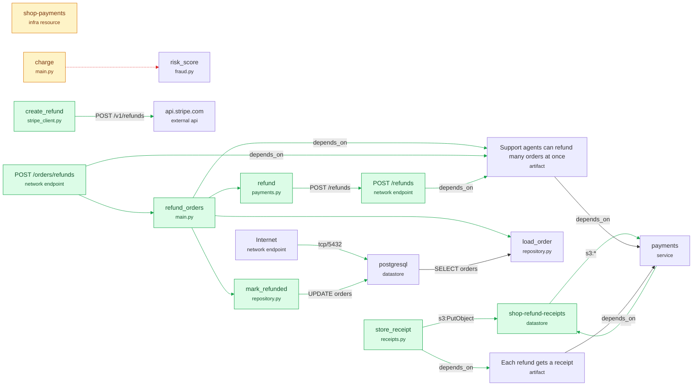

<!-- breadth-diff -->
### breadth · what this change does

**12 changes worth a close look** · +6 functions · 1 changed · +2 endpoints · 22 connections added, 1 removed

#### Against the spec
**OpenSpec change `add-bulk-refunds`**: Add bulk refunds · tasks 1/3 · requirements implemented 2/2 (2 by this pull request) (code in the pull request implements its requirements; branch add-bulk-refunds)

**Outside the spec change** (4): not reached from the code or targets its requirements name.
- 🔴 postgresql is now reachable from the internet (tcp/5432): PostgreSQL (5432)
- 🔴 shop-payments is now allowed s3:* on *
- 🔴 charge no longer calls risk_score: a check was removed
- 🔴 new datastore shop-refund-receipts

#### Worth a close look
- 🔴 postgresql is now reachable from the internet (tcp/5432): PostgreSQL (5432) `infra/terraform/data.tf` · **outside spec change `add-bulk-refunds`**
- 🔴 shop-payments is now allowed s3:* on * `infra/terraform/iam.tf` · **outside spec change `add-bulk-refunds`**
- 🔴 charge no longer calls risk_score: a check was removed `services/payments/app/main.py` · **outside spec change `add-bulk-refunds`**
- 🔴 mark_refunded now writes to postgresql (UPDATE orders) `services/orders/app/repository.py`
- 🔴 store_receipt now writes to shop-refund-receipts (s3:PutObject) `services/payments/app/receipts.py`
- 🔴 create_refund now calls the external API api.stripe.com (POST /v1/refunds) `services/payments/app/stripe_client.py`
- 🔴 refund_orders now calls load_order inside a loop, and load_order does I/O (database or network) `services/orders/app/main.py`
- 🔴 refund_orders now calls mark_refunded inside a loop, and mark_refunded does I/O (database or network) `services/orders/app/main.py`
- 🔴 new endpoint POST /orders/refunds in orders `services/orders/app/main.py`
- 🔴 new endpoint POST /refunds in payments `services/payments/app/main.py`
- 🔴 new datastore shop-refund-receipts `infra/terraform/receipts.tf` · **outside spec change `add-bulk-refunds`**
- 🔴 payments can now write to shop-refund-receipts (IAM: s3:*) `services/payments/app`

#### Also changes
- 🟠 refund now calls POST /refunds `services/orders/app/payments.py`
- 🟠 payments can now read from shop-refund-receipts (IAM: s3:*) `services/payments/app`
- ⚪ refund_orders now implements "Support agents can refund many orders at once" `services/orders/app/main.py`
- ⚪ POST /orders/refunds now implements "Support agents can refund many orders at once" `services/orders/app/main.py`
- ⚪ POST /refunds now implements "Support agents can refund many orders at once" `services/payments/app/main.py`
- ⚪ store_receipt now implements "Each refund gets a receipt" `services/payments/app/receipts.py`
- ⚪ new infrastructure payments-receipts (aws_iam_role_policy) `infra/terraform/receipts.tf`
- ⚪ new finding: charge and refund are nearly identical `services/orders/app/payments.py`
- ⚪ new finding: payments may read from shop-refund-receipts, but its code never does `services/payments/app`
- ⚪ new finding: create_refund calls api.stripe.com with no error handling `services/payments/app/stripe_client.py`
- ⚪ new finding: refund calls POST /refunds with no error handling `services/orders/app/payments.py`

<b>Picture of the change</b> (green added, red removed, amber changed)

✅ Resolves: "Each refund gets a receipt" refers to store_receipt, which does not exist; "Support agents can refund many orders at once" refers to refund_orders, POST /orders/refunds, POST /refunds, which do not exist

All structural changes

**Added** (8): `refund_orders`, `refund`, `mark_refunded`, `refund`, `store_receipt`, `create_refund`, `POST /orders/refunds`, `POST /refunds`

**Changed** (1): `charge`

breadth compared main → add-bulk-refunds by scanning both versions. It maps structure and data flow; dynamic calls and runtime-only behaviour are not visible.
