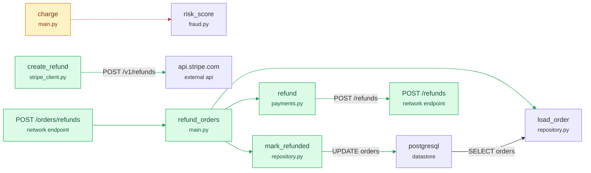

<!-- breadth-diff -->
### breadth · what this change does

**7 changes worth a close look** · +5 functions · 1 changed · +2 endpoints · 11 connections added, 1 removed

#### Worth a close look
- 🔴 charge no longer calls risk_score: a check was removed `services/payments/app/main.py`
- 🔴 mark_refunded now writes to postgresql (UPDATE orders) `services/orders/app/repository.py`
- 🔴 create_refund now calls the external API api.stripe.com (POST /v1/refunds) `services/payments/app/stripe_client.py`
- 🔴 refund_orders now calls load_order inside a loop, and load_order does I/O (database or network) `services/orders/app/main.py`
- 🔴 refund_orders now calls mark_refunded inside a loop, and mark_refunded does I/O (database or network) `services/orders/app/main.py`
- 🔴 new endpoint POST /orders/refunds in orders `services/orders/app/main.py`
- 🔴 new endpoint POST /refunds in payments `services/payments/app/main.py`

#### Also changes
- 🟠 refund now calls POST /refunds `services/orders/app/payments.py`
- ⚪ new finding: charge and refund are nearly identical `services/orders/app/payments.py`
- ⚪ new finding: create_refund calls api.stripe.com with no error handling `services/payments/app/stripe_client.py`
- ⚪ new finding: refund calls POST /refunds with no error handling `services/orders/app/payments.py`

<b>Picture of the change</b> (green added, red removed, amber changed)

All structural changes

**Added** (7): `refund_orders`, `refund`, `mark_refunded`, `refund`, `create_refund`, `POST /orders/refunds`, `POST /refunds`

**Changed** (1): `charge`

breadth compared main → add-bulk-refunds by scanning both versions. It maps structure and data flow; dynamic calls and runtime-only behaviour are not visible.
